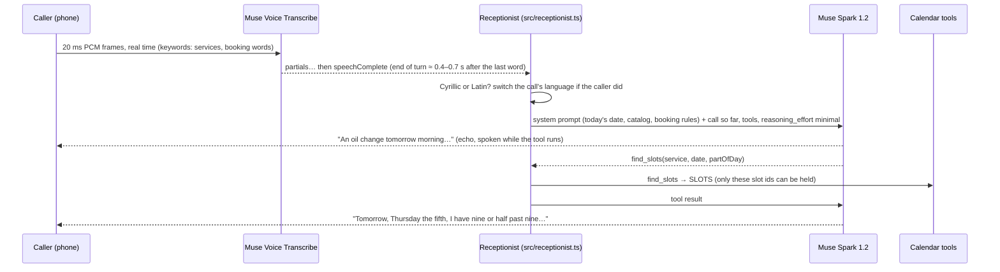
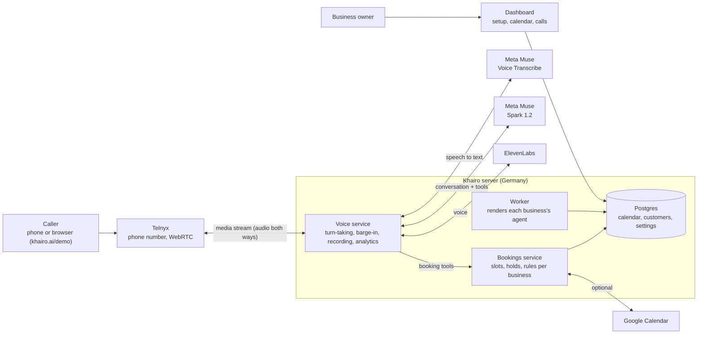

# Khairo Receptionist on Meta Muse

**A phone receptionist that answers a small business's calls and books the appointment, in Bulgarian or English,
built on Meta's Muse Voice Transcribe and Muse Spark.**

> **Try it live (English):** talk to it in your browser at **[khairo.ai/demo](https://khairo.ai/demo)**, or call
> **+1 (415) 873-5520**. It's the receptionist of _Golden Gate Auto Care_, a demo car service in San Francisco: ask
> about prices and hours, then book an appointment. It runs on our production platform, on Muse Voice Transcribe and
> Muse Spark 1.2.

This is the voice core of [Khairo](https://khairo.ai), our AI receptionist for appointment businesses (car services
first, then dental clinics and salons). We made it public for the
[Meta Global AI Developer Hackathon](https://cerebralvalley.ai/e/meta-ai-developer-hackathon) (Startup track, _Build for
Your World_). Both Meta models answer our live phone lines today.

| The live demo | A booking from a demo call, in the business's calendar |
| --- | --- |
|  |  |

```
caller › Здравейте, искам да запиша час за смяна на масло, утре сутринта.
         (Hello, I'd like to book an oil change, tomorrow morning.)
    muse-voice-transcribe: end of turn 691 ms after the last word
  agent › Смяна на масло утре сутринта — проверявам свободните часове.
         (An oil change tomorrow morning, I'm checking the free times.)   ← spoken while the tool runs
  ⚙ find_slots({"service":"oil_change","date":"2026-11-05","partOfDay":"morning"})
  agent › За утре, четвъртък пети, сутринта има свободни часове в девет часа и в девет и половина. Кой от тях Ви е удобен?
         (Tomorrow, Thursday the fifth, I have nine or half past nine. Which suits you?)

caller › Първия час е добре. На името на Иван Петров.   (The first one is fine. Under the name Ivan Petrov.)
  agent › Девет часа за Иван Петров — задържам часа за вас.   (Nine for Ivan Petrov, I'm holding it for you.)
  ⚙ hold_slot({"slotId":"2026-11-05T09:00/oil_change","name":"Иван Петров"})
  agent › Записвам на име Иван Петров, смяна на масло, четвъртък пети, в девет сутринта. Така ли е?
         (Ivan Petrov, an oil change, Thursday the fifth at nine in the morning. Is that right?)

caller › Да, точно така.   (Yes, that's right.)
  ⚙ confirm_booking({"callerConfirmed":true})
  agent › Записано е. Очакваме Ви в четвъртък пети в девет сутринта. Приятен ден!   (Booked. See you Thursday at nine.)
```

_A real run of `pnpm call samples/bg-oil-change/*.wav`: synthetic caller audio, streamed at real time through both Muse
models._

## The problem

Owner-run businesses still live on the phone, and the owner can't pick up: they're under a car, at the dental chair, or
with a client. In Bulgaria only 17.6% of people booked a doctor or practitioner online in 2024, against 39.8% across the
EU (Eurostat). When a call goes unanswered, the caller rings the next garage on the list, and a car-service job is worth
€50–300.

A receptionist that fixes this has to do three hard things at once on a phone line:

1. **Hear Bulgarian phone audio right**, including the words a booking depends on ("час" (appointment), "понеделник"
   (Monday), the business's own service names), and know when the caller has finished.
2. **Answer fast enough to feel like a person**, while it calls tools to find, hold and confirm a slot.
3. **Never book something the caller didn't agree to**, and never invent a time, a price or opening hours.

## What Meta's models do here

| | Model | Job | Why this one |
| --- | --- | --- | --- |
| 👂 | **Muse Voice Transcribe** (`muse-voice-transcribe-1.0`, realtime WebSocket) | Turns the caller's audio into text and decides when their turn has ended | On our real Bulgarian calls: **20.0% word error rate vs 29.7%** for Deepgram Nova-3, **every booking-critical word right (35/35)**, end of turn **~0.4 s** after the last word vs up to 6.9 s, at about a third of the price. [Benchmark](docs/benchmarks/muse-transcribe-vs-deepgram.md) |
| 🧠 | **Muse Spark 1.2** (Chat Completions, streamed, with tools) | Talks to the caller and books through `find_slots` → `hold_slot` → `confirm_booking` | **36/36 right tool with right inputs**, relative dates resolved ("утре сутринта" → `2026-11-05`, `morning`), **0.8 s median first token** at `reasoning_effort: minimal`. [Benchmark](docs/benchmarks/muse-spark-for-voice.md) |

Two properties of the models shaped the design:

- **Muse Voice Transcribe code-switches.** English speech on a stream biased to Bulgarian comes back as English words,
  not Cyrillic noise. So the receptionist follows a caller into English from their first sentence. It decides by the
  script of the words ([`src/language.ts`](src/language.ts), instant, no model call), without reopening the stream.
- **Muse Spark streams text before a tool call.** A booking turn needs two model rounds (the tool call, then the reply
  about its result), which left callers in 2.2–2.9 s of silence. Now the model starts each tool turn with a short echo of
  what the caller just said ("A brake inspection tomorrow afternoon, I'll check what we have."). The echo is spoken while
  the tool and the second round run, so a booking turn starts talking after ~0.4–1.2 s instead. In our test, 12 of 12
  turns still called the tool. A generic "one moment" is only a fallback, played when nothing else is ready.

## How a call flows



This repo prints the replies so you can run the whole Meta part with nothing but a Meta API key. In production they're
spoken, as below.

## How it runs in production



- **A business sets itself up in the dashboard:** services with prices and durations, staff and equipment (a mechanic
  and a lift, a dentist and a chair), opening hours and rules. The worker renders that into the agent: the prompt, the
  booking tools, the greeting and the voice. Then they forward their own number to us.
- **Every call is the same pipeline**, whether it comes from a phone or from the browser demo: Muse Voice Transcribe
  hears the caller and ends their turn, Muse Spark talks and calls the booking tools, ElevenLabs speaks the reply. The
  caller can interrupt at any time.
- **The bookings service decides, not the model.** The model can only offer slots the service returned. A held slot is
  checked again right before it's confirmed, and it's confirmed only after the caller agrees to a read-back of the name,
  day and time.
- **Every call is recorded and measured** (stereo recording, transcript, timing per stage, cost, post-call analysis),
  and the analytics page shows where each reply's wait goes:


### Production numbers (Muse Spark 1.2 + Muse Voice Transcribe, Nov 2026)

| | |
| --- | --- |
| Caller's last word → agent's voice | **p50 1.86 s, p95 2.78 s** (33 turns, through telephony and text-to-speech) |
| Where that time goes (p50) | Muse Spark 78%, end of turn 11%, voice first audio 6%, booking tools 4% |
| Cost per call | **$0.087** (about 5¢ a minute: voice 47%, Muse Spark 26%, telephony 21%, Muse Voice Transcribe 6%) |
| Live receptionists | A Bulgarian clinic and the English demo garage, both on both Muse models |

What production taught us is in each benchmark's notes: the 30-character keyword limit, the `reasoning_effort` floor,
`tool_choice: "auto"` only, the automatic prompt cache, and a "Да" that came back with no words.

## Try it

You need Node 22+, pnpm and a [Meta Model API key](https://dev.meta.ai).

```bash
pnpm install
cp .env.example .env          # add META_MODEL_API_KEY

pnpm call samples/bg-oil-change/*.wav    # a Bulgarian call: audio → Muse Voice Transcribe → Muse Spark → booking
pnpm call samples/en-tyre-change/*.wav   # an English caller on a Bulgarian line: the call switches language
pnpm chat                                # be the caller: type in Bulgarian or English
pnpm bench:spark                         # first-token latency and tool accuracy; --models, --efforts, --runs
```

`pnpm call` plays each WAV as one caller turn, in 20 ms frames at real time with silence in between, the way a phone
line delivers audio. It prints what Muse heard, every tool call and its answer, what the agent says, and a timing table:

```
| turn | end of turn (STT) | first token (LLM) | tool calls | reply done |
|---|---|---|---|---|
| 1 | 691 ms | 1025 ms | find_slots | 1897 ms |
| 2 | 552 ms | 745 ms | hold_slot | 1408 ms |
| 3 | 590 ms | 908 ms | confirm_booking | 1390 ms |
```

Your own audio works too: any 16-bit PCM WAV, one file per caller turn.

## What's in this repo

| Path | What |
| --- | --- |
| [`src/meta/muse-transcribe.ts`](src/meta/muse-transcribe.ts) | Muse Voice Transcribe realtime client: handshake, endpointing, cumulative partials, keyword limits. From our production provider |
| [`src/meta/muse-spark.ts`](src/meta/muse-spark.ts) | Muse Spark streaming client with tool calls, `reasoning_effort`, first-token timing and cache usage |
| [`src/receptionist.ts`](src/receptionist.ts) | The receptionist: prompt, tool loop, language following |
| [`src/language.ts`](src/language.ts) | Script-based language switch, unchanged from production |
| [`src/calendar.ts`](src/calendar.ts) | A demo car service and its calendar behind the three booking tools, with production's offer policy (two times, spread apart) |
| [`src/cli/`](src/cli) | `call` (WAV → full pipeline), `chat` (text), `bench-spark` (latency and accuracy) |
| [`docs/benchmarks/`](docs/benchmarks) | How we chose Muse: methods, numbers, trade-offs |
| [`samples/`](samples) | Synthetic caller turns (ElevenLabs voices; no real caller audio) |

**Not in this repo** (Khairo's private platform): telephony, text-to-speech, turn-taking and barge-in, the bookings
service with each business's rules, reminders and recall calls, onboarding, analytics and the dashboard.

## License

Source-available under the [Khairo Source-Available License](LICENSE): you may read, run and modify it to evaluate it,
learn from it or judge it; commercial use and redistribution need our permission.

## Team

Khairo: [Vladislav Varadinov](https://github.com/Vvaradinov) (AI engineering, the voice stack) and Kristiyan (product,
onboarding, customers). Sofia, Bulgaria. [khairo.ai](https://khairo.ai)
