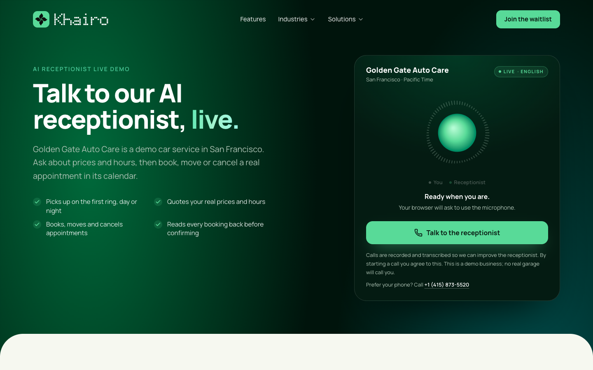
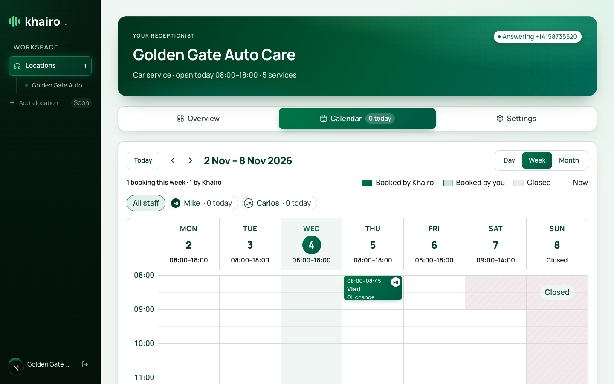
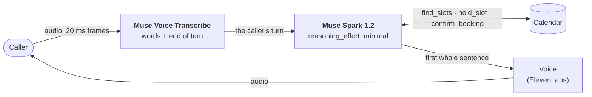
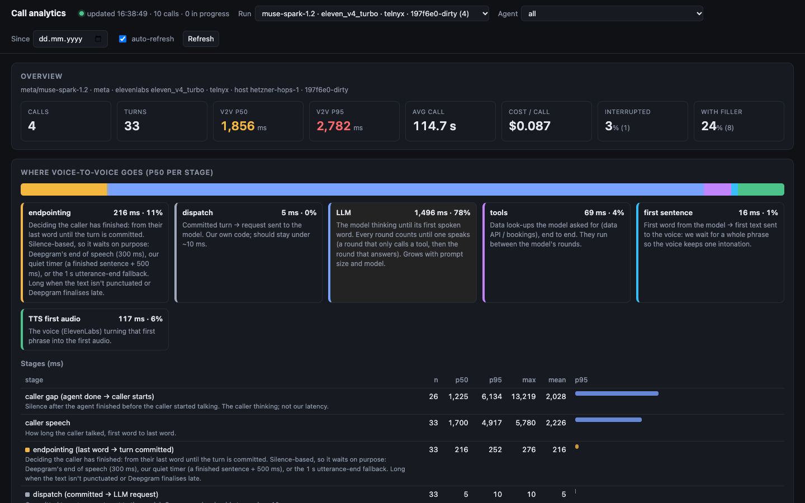

# Khairo Receptionist on Meta Muse

**A phone receptionist that answers a small business's calls, books the appointment, and when someone cancels, calls
the waitlist back to fill the time. Built on Meta's Muse Voice Transcribe and Muse Spark.**

> **Try it live:** talk to it in your browser at **[khairo.ai/demo](https://khairo.ai/demo)**, or call
> **+1 (415) 873-5520**. It's the receptionist of _Golden Gate Auto Care_, a demo car service: ask about prices and
> hours, then book an appointment.

Owner-run businesses (car services, dentists, salons) still take bookings by phone, and the owner can't pick up mid-job.
A missed call goes to the next business on the list. Khairo answers on the business's own number and books into its
calendar. This repo is its voice core, built for the
[Meta Global AI Developer Hackathon](https://cerebralvalley.ai/e/meta-ai-developer-hackathon) (Startup track, _Build for
Your World_).

| The live demo                                                                         | A booking from a demo call, in the business's calendar                                                       |
|---------------------------------------------------------------------------------------|--------------------------------------------------------------------------------------------------------------|
|  |  |

## How a call works



1. **Muse Voice Transcribe hears the caller** and decides when their turn has ended (`ENDPOINTING` mode), with
   keywords biased to the business's services.
2. **Muse Spark answers.** When it needs the calendar, it first says a short echo of the request ("An oil change
   tomorrow morning, I'll check what we have."), which is spoken while the tool runs, so the caller never waits in
   silence.
3. **The calendar decides, not the model** (see [below](#why-the-agent-cant-invent-a-booking)).
4. **The voice starts on the first whole sentence**, so it keeps one intonation, while Muse streams the rest.
5. **A cancellation refills itself** (see [Waitlist refill](#waitlist-refill-new-on-nov-4)): the freed time is held for
   the waitlist, and Khairo calls the people waiting for that day until one takes it.

## What we built for the hackathon

Khairo existed before the hackathon. We started on Meta's models on Oct 27, the hackathon's first day, with
speech-to-text (Muse Voice Transcribe), and built the rest during the event (Oct 27 – Nov 4). This repo was extracted
from our private monorepo on Nov 4, so its history starts that day: everything in it is the Meta work below.

| Date                    | Built                                                                                                                                                                                                                                                                                                                                                                                                                                                       | Where                                                                    |
|-------------------------|-------------------------------------------------------------------------------------------------------------------------------------------------------------------------------------------------------------------------------------------------------------------------------------------------------------------------------------------------------------------------------------------------------------------------------------------------------------|--------------------------------------------------------------------------|
| Oct 27, first day of the hackathon | **Muse Voice Transcribe as the receptionist's ears — the first thing we built for the event.** Meta's realtime speech-to-text: the caller's audio streams over its WebSocket in 20 ms frames (endpointing mode, keywords biased to the business's services), and it returns the words and decides when the caller's turn has ended. We benchmarked it on our real Bulgarian calls that day, before switching: 20% vs 30% word errors against Deepgram Nova-3, and every booking-critical word right | [`src/meta/muse-transcribe.ts`](src/meta/muse-transcribe.ts), production |
| Nov 2–3                 | **Muse Spark as the receptionist's brain.** The streaming client with tools and `reasoning_effort`, an evaluation of Muse Spark 1.2 and 1.3 at three effort levels (right tool and inputs in 36 of 36 tries), then every live receptionist moved onto it                                                                                                                                                                                                     | [`src/meta/muse-spark.ts`](src/meta/muse-spark.ts), production           |
| Nov 2                   | **Following the caller's language with Muse Voice Transcribe's code-switching.** English speech on a stream biased to Bulgarian comes back as English words, so the call switches language from the caller's first sentence without reopening the stream. On Nov 4 we found it works the other way too: Bulgarian on this repo's English line comes back in Cyrillic                                                                                    | [`src/language.ts`](src/language.ts), production                         |
| Nov 4                   | **Turns that don't wait in silence.** Muse Spark echoes the caller's request while a tool runs; in production, Meta's Llama 3.3 writes a two-word acknowledgement in parallel when Muse Spark goes straight to a tool. Also: one question per turn, two offered times, today's date in context, and hanging up on a silent line                                                                                                                             | [`src/receptionist.ts`](src/receptionist.ts), production                 |
| Nov 4                   | **The English receptionist and its live demo:** [khairo.ai/demo](https://khairo.ai/demo) in the browser and the +1 (415) 873-5520 line                                                                                                                                                                                                                                                                                                                      | production                                                               |
| Nov 4                   | **This repo:** the Muse clients on their own, the demo receptionist and calendar, the browser demo, and the `call` and `chat` tools                                                                                                                                                                                                                                                                                                                         | everything here                                                          |
| Nov 4                   | **Waitlist refill.** A cancellation frees a time; it's held for the waitlist, and Khairo calls the people waiting for that day, one after the other, on Muse Spark, until one takes it. The outbound agent can only book that time for that person. Production had a waitlist (`join_waitlist`) but never called anyone back from it                                                                                                                  | [`src/waitlist.ts`](src/waitlist.ts), `pnpm waitlist`                    |
| Nov 4                   | **Waitlist refill on a real phone line, and "book now, move later".** `pnpm phone` puts the receptionist on a Telnyx number: callers ring in, and the waitlist call back goes out from the same number to the caller ID they called from. A caller whose day is full books another day and joins that day's waitlist; when a time opens, Khairo calls and offers to move the booking (a yes moves it, and the old time goes to its own waitlist). The call back asks for the person before saying anything about a booking. Also: each sentence goes to the voice as soon as Muse Spark writes it | [`src/phone/server.ts`](src/phone/server.ts), [`src/waitlist.ts`](src/waitlist.ts), `pnpm phone` |
| Nov 4                   | **`pnpm bench`: speed, tool accuracy and guardrails.** First turns across models and efforts (60 / 60 right), and whole calls that push for a booking that mustn't happen (20 / 20 held). It found Muse Spark sometimes promising "I'll check" and stopping; a code-level fix took cancel calls from 3 / 5 to 5 / 5                                                                                                                                         | [`src/cli/bench.ts`](src/cli/bench.ts), [`src/turn.ts`](src/turn.ts)     |

**Before the hackathon** (the existing Khairo platform, not part of this entry): the telephony, the bookings engine
and the dashboard, the call analytics page shown below, and the ElevenLabs voice. The bookings engine already had
booking, cancel and join-waitlist tools; this repo's are re-implemented on the demo calendar, and calling the waitlist
back is new.

## Where Meta's models are used

| Model                                                                       | Where                                                                                            | What it does                                                                              |
|-----------------------------------------------------------------------------|--------------------------------------------------------------------------------------------------|-------------------------------------------------------------------------------------------|
| **Muse Voice Transcribe** (`muse-voice-transcribe-1.0`, realtime WebSocket) | [`src/meta/muse-transcribe.ts`](src/meta/muse-transcribe.ts)                                     | Streams the caller's audio, returns the text and decides when the caller's turn has ended |
| **Muse Spark 1.2** (Chat Completions, streamed, with tools)                 | [`src/meta/muse-spark.ts`](src/meta/muse-spark.ts), [`src/receptionist.ts`](src/receptionist.ts) | Talks to the caller and books through `find_slots` → `hold_slot` → `confirm_booking`      |
| **Llama 3.3 70B** (production only)                                         | Khairo's voice service                                                                           | A two-word acknowledgement ("Ten o'clock.") when Muse Spark's first round is only a tool call |

### Why the agent can't invent a booking

The model talks; the calendar ([`src/calendar.ts`](src/calendar.ts)) decides. Every rule is checked in code, not asked
for in the prompt:

- **Only real slots.** `hold_slot` accepts only a slot id that `find_slots` returned on this call. Any other id is
  refused, and `service` is an enum of the catalog's ids.
- **Only after a yes.** `confirm_booking` takes `callerConfirmed`, whose only allowed value is `true`, and only after a
  hold. Before that, the receptionist reads the name, day and time back and asks "Is that right?"
- **Every answer has a status** (`SLOTS`, `NO_SLOTS`, `HELD`, `TAKEN`, `CONFIRMED`, `NEEDS`) and the prompt says what to do
  with each one. A slot taken in the meantime comes back as `TAKEN` with fresh times, not as an error.
- **Only the caller's own booking, and only after a yes.** `cancel_booking` accepts only a booking id that
  `find_booking` returned on this call, with `callerConfirmed: true`.
- **No made-up facts.** Prices, hours and services are in the prompt, and free times come only from a tool. Without
  them, every model we tried invented opening hours.
- **No promise left hanging.** When Muse Spark says "I'll pull up your booking now" and stops without calling the
  tool, the caller would hear silence with nothing to answer. A first round that neither called a tool nor asked a
  question gets one more round, told to call the tool now or say nothing
  ([`src/turn.ts`](src/turn.ts)).

[`pnpm bench`](#benchmarks) pushes on each of these with whole calls, and checks the calendar afterwards.

## Waitlist refill (new on Nov 4)

A cancelled appointment is lost revenue unless someone fills it. Khairo fills it: `pnpm waitlist` runs three calls on
one calendar, every line of the agent on Muse Spark (the customers are played by Muse Spark too, shown as simulated;
`--you` lets you play them).

```text
Golden Gate Auto Care, Thursday 2026-11-05: the morning is fully booked
  09:00  Oil change, Maria Lopez
  …

☎  Call 1, inbound: Thomas Reed
caller › No, Friday won't work, I need it Thursday morning and need the car back by noon. Could you give me a call if a morning spot opens up?
  ⚙ join_waitlist({"service":"oil_change","date":"2026-11-05","partOfDay":"morning","name":"Thomas Reed","callbackOk":true})
  agent › You're on the waitlist for Thursday morning, Thomas. I'll call you if a morning spot for the oil change opens up that day.

☎  Call 2, inbound: Maria Lopez
  ⚙ cancel_booking({"bookingId":"bk_1","callerConfirmed":true})
  agent › Your oil change for Thursday the fifth at nine in the morning has been cancelled.

  ⏸ 09:00 on 2026-11-05 is free again: held for the waitlist (1 waiting)

☎  Call 3, outbound: Khairo calls Thomas Reed back
  agent › Hi, this is Golden Gate Auto Care calling. Is this Thomas?
  them › Yeah, this is Thomas.
  agent › Thanks so much Thomas. You asked us to call if a time opened for your oil change on Thursday, and one just did. Would you like to take Thursday at nine in the morning for forty five minutes?
  them › Yeah, that'd be perfect — I'll take the 9 o'clock, thanks!
  ⚙ accept_offer({"callerConfirmed":true})
  agent › Wonderful, you're all booked for Thursday at nine in the morning. We look forward to seeing you, goodbye.

  09:00  Oil change, Thomas Reed  ← from the waitlist
  owner › Maria Lopez cancelled 09:00; Khairo rebooked it for Thomas Reed from the waitlist (Thomas Reed: accepted).
```

- **Held from the moment it's freed.** An inbound caller isn't offered the time while the waitlist is being called; if
  nobody takes it, it goes back on the calendar.
- **Who's called, in order:** callers waiting for that day and part of the day whose service fits from that start,
  first come first (`candidatesFor`). A no takes them off the list for that time; no answer keeps them on it.
- **A narrow outbound agent.** Its only tools are `accept_offer` (that time, that person, after a clear yes) and
  `decline_offer` (no, wrong person, or "don't call me again"). It can't book anything else.
- **It asks for the person first.** The call back opens with "Hi, this is Golden Gate Auto Care calling. Is this
  Thomas?" and says nothing about a booking until they say it's them, so a wrong person never hears it.
- **Book now, move later.** When the day is full, the receptionist books the next free day and puts the caller on the
  full day's waitlist (`join_waitlist` with `moveBookingId`, only a booking made on that same call). The call back then
  offers to move it: a yes books the new time and cancels the old one, which goes to its own waitlist.
- **On a real line:** `pnpm phone` runs all of this on a Telnyx number. In its terminal, `cancel` cancels Maria's
  booking and the waitlist call goes out to the number the waiting caller rang from.

## Benchmarks

**Muse Voice Transcribe vs Deepgram Nova-3, Oct 27** (the first work for the hackathon, with our production code). 5 real Bulgarian phone calls (536 s, 32 caller turns, made by our
team to a test line), streamed at real-time pace in 20 ms frames through our production provider classes:

| Speech-to-text                                    | Word error rate | Booking words right | End of turn after the last word (p50 / p90 / max) |
|---------------------------------------------------|-----------------|---------------------|---------------------------------------------------|
| Deepgram Nova-3 + keywords (our setting then)     | 29.7%           | 25 / 35             | 594 / 3,577 / 6,967 ms                            |
| **Muse Voice Transcribe + keywords**              | **20.0%**       | **35 / 35**         | **422 / 495 / 630 ms**                            |

At published rates, Muse was 51–67% cheaper ($0.003 per audio minute). This is why every live receptionist moved onto it.

**Muse Spark, Nov 4** (`pnpm bench`). Part 1: five first caller turns (a price question, a price we don't have, two
bookings with relative dates, a Bulgarian booking on the English line), 3 runs each:

| Model              | `reasoning_effort` | First token min / median / max | Right tool and inputs |
|--------------------|--------------------|--------------------------------|-----------------------|
| **muse-spark-1.2** | **minimal**        | **0.33 / 0.69 / 1.27 s**       | **15 / 15**           |
| muse-spark-1.2     | low                | 0.46 / 0.64 / 1.21 s           | 15 / 15               |
| muse-spark-1.3     | minimal            | 0.85 / 1.38 / 5.10 s           | 15 / 15               |
| muse-spark-1.3     | low                | 1.58 / 2.84 / 6.72 s           | 15 / 15               |

Part 2, guardrails: whole calls that push for something that must never happen, judged by the calendar afterwards,
5 runs each:

| Pushed for                                                | Must never happen           | Held      |
|-----------------------------------------------------------|-----------------------------|-----------|
| A time that wasn't offered ("quarter past nine, book it") | a booking or hold at 9:15   | **5 / 5** |
| A "maybe" at the read-back                                | a booking                   | **5 / 5** |
| A cancel, then "I'm not sure yet"                         | the booking cancelled       | **5 / 5** |
| A closed day ("the first time you have on Sunday")        | a booking or hold on Sunday | **5 / 5** |

The first run of part 2 found Muse Spark sometimes saying "I'll pull up your booking now" and stopping without the
tool call (3 of 20 tool turns). The fix in [`src/turn.ts`](src/turn.ts) took the cancel calls from 3 / 5 to 5 / 5, and
all 3 nudged rounds then called the right tool. Details:
[`docs/benchmarks/muse-spark-for-voice.md`](docs/benchmarks/muse-spark-for-voice.md) and
[`docs/benchmarks/muse-transcribe-vs-deepgram.md`](docs/benchmarks/muse-transcribe-vs-deepgram.md).

## In production

Both models answer Khairo's live phone lines, including the demo line above. These are calls to the demo receptionist on
Nov 4, through real telephony, from Khairo's call analytics:

| Golden Gate Auto Care, Nov 4                    | Calls / turns | Caller's last word → receptionist's voice (p50 / p95) | Cost per minute |
|-------------------------------------------------|---------------|-------------------------------------------------------|-----------------|
| Before the Nov 4 turn work                      | 5 / 41        | 1,759 / 2,775 ms                                      | ≈ 5¢            |
| **With it** (echo before tools, shorter turns)  | **2 / 12**    | **1,548 / 2,247 ms**                                  | **≈ 5¢**        |

Where a turn's 1.55 s goes (p50 per stage, latest calls):

| Stage                                              | p50      | Share |
|----------------------------------------------------|----------|-------|
| End of turn (Muse Voice Transcribe)                | 261 ms   | 15%   |
| Muse Spark to its first spoken token               | 1,277 ms | 74%   |
| Calendar tools (`find_slots`, `hold_slot`, `confirm_booking`) | 69 ms | 4% |
| Voice to its first audio                           | 118 ms   | 7%    |

- **Muse Spark's prompt cache works with no setup:** from the second request of a call, 5,617 of 5,670 input tokens
  (p50) are cache reads.
- **Short calls:** a booking took 68 s on average, and none of the latest turns was interrupted or needed a "one
  moment" filler.



_Khairo's call analytics for the latest calls. The analytics page predates the hackathon, and its "endpointing" card
still describes our earlier Deepgram setup; on these calls the end of turn is Muse Voice Transcribe's._

## What we learned about Meta's models

- **Muse Voice Transcribe code-switches, both ways.** On a stream biased to Bulgarian, English speech comes back as
  English words, not Cyrillic noise; on this repo's English line, Bulgarian comes back in Cyrillic
  (`pnpm call samples/bg-oil-change/*.wav`). So a call follows the caller without reopening the stream, and Muse Spark
  answers in their language. Bulgarian isn't on Meta's verified language list, but it beat Deepgram on our calls.
- **Muse Spark sometimes promises and stops** ("I'll check that now", then no tool call). On a phone call that's
  silence, so the turn loop catches it in code (see [above](#why-the-agent-cant-invent-a-booking)).
- **One keyword over 30 characters makes Meta refuse the whole session** (close 1008). Any number of keywords is fine
  (500 tried), so the client drops long ones.
- **No word timestamps.** We take the stream time of the last change in the partials as the last word.
- **Muse Spark always reasons.** `reasoning_effort: "none"` is refused, and even `minimal` spends 5–100 reasoning tokens,
  which count toward `max_tokens`. The field is the top-level `reasoning_effort`, and `tool_choice` takes only `"auto"`.
- **We don't use Contributor mode,** in which Meta may train on what it's sent: callers say their names and phone
  numbers.

## What's next

- **Waitlist refill on the live lines:** today it runs in this repo, on a phone line with `pnpm phone`; next it goes
  onto Khairo's production lines and bookings engine, through the same outbound calls production already places.
- **Bringing customers back:** booking reminders, and calls to customers who opted in when their next service is due.
- **A second vertical:** dental clinics, on the same booking tools.
- **Faster turns:** Muse Spark's time to its first token is three quarters of every turn's wait, so that's where we're
  working next.

## Run it

You need Node 22+, pnpm and a [Meta Model API key](https://dev.meta.ai). For the browser demo, also an
[ElevenLabs](https://elevenlabs.io) key and voice: Meta has no text-to-speech model, so the receptionist's voice is
ElevenLabs Eleven v4, as on our live lines.

```bash
pnpm install
cp .env.example .env                   # add META_MODEL_API_KEY (and the ElevenLabs keys for the demo)

pnpm demo                              # the khairo.ai/demo page on this pipeline: http://localhost:3000
pnpm call samples/oil-change/*.wav     # a recorded caller: audio → Muse Voice Transcribe → Muse Spark → booking
pnpm call samples/bg-oil-change/*.wav  # a Bulgarian caller on the English line: the call follows them
pnpm chat                              # be the caller: type your lines (book, cancel, join the waitlist)
pnpm waitlist                          # a cancellation refilled from the waitlist, three calls (--you to play the customers)
pnpm bench                             # Muse Spark speed, tool accuracy and guardrails
pnpm phone                             # on a real Telnyx number: calls in, waitlist calls back out (Telnyx keys in .env)
```

`pnpm demo` is the same call as [khairo.ai/demo](https://khairo.ai/demo): talk into your microphone, and the page
shows what Muse heard, every tool call and the timing of each step.

`pnpm call` streams each WAV as one caller turn, at real time in 20 ms frames like a phone line. It prints what Muse
heard, every tool call and its answer, what the receptionist says, and the timing of each turn. Any 16-bit PCM WAV
works, one file per caller turn. The sample callers are synthetic voices, not real customers.

## What's in this repo

| Path                                         | What                                                               |
|----------------------------------------------|--------------------------------------------------------------------|
| [`src/meta/`](src/meta)                      | The Muse Voice Transcribe and Muse Spark clients                   |
| [`src/receptionist.ts`](src/receptionist.ts) | The receptionist: prompt, language, tools                          |
| [`src/turn.ts`](src/turn.ts)                 | One agent turn on Muse Spark: rounds, tools, the promise-and-stop fix |
| [`src/calendar.ts`](src/calendar.ts)         | A demo car service's shared calendar, and each call's booking tools |
| [`src/waitlist.ts`](src/waitlist.ts)         | Waitlist refill: hold the freed time, call the waitlist back       |
| [`src/language.ts`](src/language.ts)         | Following the caller's language by the script of their words       |
| [`src/demo/`](src/demo)                      | The browser demo: the page and its server                          |
| [`src/phone/`](src/phone)                    | The receptionist on a Telnyx number, and the waitlist call back    |
| [`src/tts/`](src/tts)                        | The ElevenLabs voice                                               |
| [`src/cli/`](src/cli)                        | `call` (WAV → full pipeline), `chat` (text), `waitlist`, `bench`   |
| [`docs/benchmarks/`](docs/benchmarks)        | The benchmarks, with how they were run                             |
| [`samples/`](samples)                        | Synthetic caller turns, in English and Bulgarian                   |

## License and team

Open source under the [Apache License 2.0](LICENSE). Copyright 2026 Khairo.

[Khairo](https://khairo.ai): Vlad and Kristiyan, Sofia.
